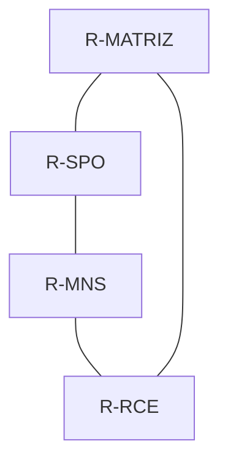

# ADO 03 — Redes de Computadores

Projetos de redes corporativas desenvolvidos para a disciplina de Redes de Computadores, utilizando o **Cisco Packet Tracer**. A atividade aborda segmentação por VLANs, endereçamento IPv4 com VLSM, roteamento entre redes e serviços de infraestrutura.

## Escopo e situação dos projetos

| Projeto | Objetivo | Situação documentada |
|---|---|---|
| Exercício 1 | Segmentar os departamentos de uma empresa | Projeto de referência; implementação e testes não confirmados nesta documentação |
| Exercício 2 | Interligar matriz e filiais em anel | Topologia representativa montada, com serviços e testes descritos abaixo |

O exercício 2 utiliza **um switch de acesso e dois computadores por unidade**. As máscaras e os pools DHCP foram dimensionados para a quantidade total de estações solicitada no enunciado. Essa representação permite demonstrar os serviços e a conectividade, mas não comprova capacidade física de portas para todas as estações previstas.

## Exercício 1 — Segmentação por departamentos

### Requisitos

| Departamento | Computadores |
|---|---:|
| Financeiro | 10 |
| Logística | 4 |
| Expedição | 3 |
| Almoxarifado | 4 |
| Comercial — compras e vendas | 26 |
| RH | 4 |
| Faturamento e recebimento | 6 |
| **Total** | **57** |

### Arquitetura proposta

A rede utiliza uma **estrela estendida**, com um switch multilayer **3560-24PS** como core e switches **2960-24TT** nos departamentos. Cada setor possui uma VLAN e uma sub-rede próprias.

Na proposta que representa todos os computadores, o Comercial utiliza dois switches de acesso para acomodar suas 26 estações. Os dois pertencem à mesma VLAN.

O core executa o roteamento entre VLANs por meio de interfaces virtuais, chamadas SVIs, e do comando `ip routing`. A comunicação entre departamentos é permitida; os broadcasts permanecem separados por VLAN.

> A regra 5-4-3 citada no enunciado se refere a redes Ethernet antigas com repetidores: até cinco segmentos, quatro repetidores e três segmentos povoados no caminho entre estações. Ela não determina a quantidade de switches de uma rede Ethernet comutada. O projeto adota a arquitetura solicitada de core e switches departamentais, com segmentação lógica por VLAN.

### Plano de endereçamento

Bloco utilizado: **192.168.10.0/24**. O dimensionamento considera computadores, gateway e gerenciamento dos switches de acesso.

| Departamento | VLAN | Rede | Máscara | Gateway | Broadcast |
|---|---:|---|---|---|---|
| Comercial | 50 | 192.168.10.0/27 | 255.255.255.224 | 192.168.10.1 | 192.168.10.31 |
| Financeiro | 10 | 192.168.10.32/28 | 255.255.255.240 | 192.168.10.33 | 192.168.10.47 |
| Faturamento e recebimento | 70 | 192.168.10.48/28 | 255.255.255.240 | 192.168.10.49 | 192.168.10.63 |
| Logística | 20 | 192.168.10.64/29 | 255.255.255.248 | 192.168.10.65 | 192.168.10.71 |
| Expedição | 30 | 192.168.10.72/29 | 255.255.255.248 | 192.168.10.73 | 192.168.10.79 |
| RH | 60 | 192.168.10.80/29 | 255.255.255.248 | 192.168.10.81 | 192.168.10.87 |
| Almoxarifado | 40 | 192.168.10.88/29 | 255.255.255.248 | 192.168.10.89 | 192.168.10.95 |

| Departamento | IPs dos switches | IPs das estações |
|---|---|---|
| Comercial | 192.168.10.2 e 192.168.10.3 | 192.168.10.4–192.168.10.29 |
| Financeiro | 192.168.10.34 | 192.168.10.35–192.168.10.44 |
| Faturamento e recebimento | 192.168.10.50 | 192.168.10.51–192.168.10.56 |
| Logística | 192.168.10.66 | 192.168.10.67–192.168.10.70 |
| Expedição | 192.168.10.74 | 192.168.10.75–192.168.10.77 |
| RH | 192.168.10.82 | 192.168.10.83–192.168.10.86 |
| Almoxarifado | 192.168.10.90 | 192.168.10.91–192.168.10.94 |

### Configurações principais

- VLAN exclusiva para cada departamento.
- Portas dos computadores em modo `access`, na VLAN correspondente.
- Enlaces entre core e switches de acesso em modo `trunk`, permitindo a VLAN do setor.
- Gateway de cada rede configurado em uma SVI do core.
- Endereçamento estático nas estações e nos switches de acesso.

## Exercício 2 — Matriz e filiais

### Requisitos e representação

| Unidade | Estações previstas | Servidores | Impressoras | PCs representados |
|---|---:|---|---:|---:|
| Matriz | 387 | DNS primário, DNS secundário, arquivos e DHCP | 1 | 2 |
| SPO | 256 | WEB e DHCP | 1 | 2 |
| MNS | 24 | DHCP | 1 | 2 |
| RCE | 120 | E-mail e DHCP | 1 | 2 |
| **Total** | **787** | **9 servidores** | **4** | **8** |

> O enunciado menciona quatro filiais, mas especifica somente SPO, MNS e RCE. O projeto contempla a matriz e essas três filiais. A quarta unidade depende de requisitos não fornecidos.

### Topologia

Quatro roteadores **Cisco 2911** são conectados diretamente em anel. Em cada unidade há um switch concentrador, um switch de acesso, servidores, uma impressora e dois PCs.



Em cada unidade:

- `Gi0/0` do roteador conecta à `Gi0/1` do concentrador.
- `Gi0/1` do switch de acesso conecta à `Fa0/1` do concentrador.
- Os dois PCs conectam às portas `Fa0/1` e `Fa0/2` do switch de acesso.
- Servidores e impressora conectam diretamente ao concentrador.

Os switches locais utilizam a **VLAN 10** e enlaces em modo access, pois transportam somente essa VLAN. O mesmo identificador de VLAN nas diferentes unidades não une seus broadcasts: as redes são separadas pelos roteadores.

Os switches deste exercício não possuem IP de gerenciamento. Os endereços das sub-redes são utilizados por estações, servidores, impressoras e gateways.

### Dimensionamento IPv4

A capacidade de uma sub-rede IPv4 convencional é calculada por `2^h - 2`, sendo `h` a quantidade de bits de host.

| Unidade | Estações + servidores + impressora + gateway | Hosts necessários | Prefixo | Hosts disponíveis |
|---|---|---:|---|---:|
| Matriz | 387 + 4 + 1 + 1 | 393 | /23 | 510 |
| SPO | 256 + 2 + 1 + 1 | 260 | /23 | 510 |
| MNS | 24 + 1 + 1 + 1 | 27 | /27 | 30 |
| RCE | 120 + 2 + 1 + 1 | 124 | /25 | 126 |

SPO precisa de `/23`: uma rede `/24` oferece apenas 254 hosts válidos, quantidade insuficiente até para suas 256 estações.

| Unidade | Rede | Máscara | Gateway | Broadcast |
|---|---|---|---|---|
| Matriz | 10.0.0.0/23 | 255.255.254.0 | 10.0.0.1 | 10.0.1.255 |
| SPO | 10.0.2.0/23 | 255.255.254.0 | 10.0.2.1 | 10.0.3.255 |
| MNS | 10.0.4.0/27 | 255.255.255.224 | 10.0.4.1 | 10.0.4.31 |
| RCE | 10.0.4.128/25 | 255.255.255.128 | 10.0.4.129 | 10.0.4.255 |

### Enlaces do anel

Todos os enlaces utilizam máscara **255.255.255.252 (/30)**.

| Enlace | Rede | Interface e IP da primeira ponta | Interface e IP da segunda ponta |
|---|---|---|---|
| Matriz–SPO | 10.255.0.0/30 | Matriz Gi0/1 — 10.255.0.1 | SPO Gi0/2 — 10.255.0.2 |
| SPO–MNS | 10.255.0.4/30 | SPO Gi0/1 — 10.255.0.5 | MNS Gi0/2 — 10.255.0.6 |
| MNS–RCE | 10.255.0.8/30 | MNS Gi0/1 — 10.255.0.9 | RCE Gi0/2 — 10.255.0.10 |
| RCE–Matriz | 10.255.0.12/30 | RCE Gi0/1 — 10.255.0.13 | Matriz Gi0/2 — 10.255.0.14 |

### Roteamento

O projeto utiliza **OSPF, processo 1, área 0**.

| Roteador | Router ID |
|---|---|
| R-MATRIZ | 1.1.1.1 |
| R-SPO | 2.2.2.2 |
| R-MNS | 3.3.3.3 |
| R-RCE | 4.4.4.4 |

As interfaces LAN são passivas no OSPF. As interfaces `Gi0/1` e `Gi0/2` formam as vizinhanças entre roteadores. O anel oferece um caminho alternativo após a reconvergência do protocolo caso um enlace seja interrompido.

### Servidores e impressoras

Todos os equipamentos abaixo utilizam IP estático, máscara e gateway da respectiva unidade. O DNS utilizado pelos clientes é **10.0.0.2**.

| Unidade | Equipamento | IP |
|---|---|---|
| Matriz | SRV-DNS1 | 10.0.0.2 |
| Matriz | SRV-DNS2 | 10.0.0.3 |
| Matriz | SRV-ARQUIVOS | 10.0.0.4 |
| Matriz | SRV-DHCP-MATRIZ | 10.0.0.5 |
| Matriz | IMP-MATRIZ | 10.0.0.6 |
| SPO | SRV-WEB | 10.0.2.2 |
| SPO | SRV-DHCP-SPO | 10.0.2.3 |
| SPO | IMP-SPO | 10.0.2.4 |
| MNS | SRV-DHCP-MNS | 10.0.4.2 |
| MNS | IMP-MNS | 10.0.4.3 |
| RCE | SRV-EMAIL | 10.0.4.130 |
| RCE | SRV-DHCP-RCE | 10.0.4.131 |
| RCE | IMP-RCE | 10.0.4.132 |

### DHCP

Cada unidade possui seu próprio servidor DHCP. Como servidor e clientes estão na mesma rede local, não foi necessário configurar relay com `ip helper-address`.

| Unidade | IP inicial | IP final do pool | Máximo de clientes | Gateway |
|---|---|---|---:|---|
| Matriz | 10.0.0.10 | 10.0.1.140 | 387 | 10.0.0.1 |
| SPO | 10.0.2.10 | 10.0.3.9 | 256 | 10.0.2.1 |
| MNS | 10.0.4.4 | 10.0.4.27 | 24 | 10.0.4.1 |
| RCE | 10.0.4.133 | 10.0.4.252 | 120 | 10.0.4.129 |

O pool `serverPool` foi aproveitado e editado em **Services → DHCP**, mantendo um único pool por servidor. Os servidores permanecem com IP estático; somente os PCs solicitam configuração por DHCP.

### DNS

Os servidores **10.0.0.2** e **10.0.0.3** possuem os seguintes registros do tipo A:

| Nome | IP |
|---|---|
| www.empresa.test | 10.0.2.2 |
| arquivos.empresa.test | 10.0.0.4 |
| mail.empresa.test | 10.0.4.130 |
| dns1.empresa.test | 10.0.0.2 |
| dns2.empresa.test | 10.0.0.3 |

Os registros são mantidos manualmente nos dois servidores. A representação não utiliza transferência automática de zona. Os clientes recebem o DNS primário pelo DHCP; o secundário pode ser consultado explicitamente para teste.

### Aplicações

| Serviço | Local | Configuração |
|---|---|---|
| WEB | SPO | HTTP disponível em `http://www.empresa.test` |
| Arquivos | Matriz | FTP disponível em `arquivos.empresa.test` |
| E-mail | RCE | SMTP e POP3 em `mail.empresa.test`, domínio `empresa.test` |

Os clientes de e-mail da matriz e de RCE foram utilizados para validar envio e resposta entre unidades. Não é necessário configurar uma conta em cada PC para demonstrar esse serviço.

As credenciais de laboratório devem ser consultadas na configuração dos servidores do arquivo `.pkt`. São contas fictícias destinadas somente à simulação.

## Validação

### Testes confirmados durante a montagem do exercício 2

- Formação de vizinhanças OSPF; dois vizinhos em estado `FULL` na matriz.
- Ping entre roteadores do anel.
- Atribuição de endereços por DHCP nas quatro unidades.
- Comunicação da matriz para as filiais e das filiais para a matriz.
- Resolução DNS e abertura do site pelo nome.
- Acesso ao serviço FTP.
- Envio e resposta de e-mail entre matriz e RCE.
- Funcionamento da montagem com switches de acesso e PCs representativos.

As quatro impressoras foram adicionadas e configuradas. O teste de redundância do anel, a verificação individual dos PCs adicionais e os pings das impressoras compõem a conferência final; seus resultados devem ser registrados após execução.

### Comandos para conferência

Nos roteadores:

```text
show ip interface brief
show ip ospf neighbor
show ip route
```

Nos computadores:

```text
ipconfig /all
ping 10.0.0.1
ping 10.0.2.2
ping 10.0.4.2
ping 10.0.4.130
nslookup www.empresa.test
nslookup www.empresa.test 10.0.0.3
ftp arquivos.empresa.test
```

Para verificar as impressoras a partir da matriz:

```text
ping 10.0.0.6
ping 10.0.2.4
ping 10.0.4.3
ping 10.0.4.132
```

### Teste de redundância do anel

1. No R-MATRIZ, desativar temporariamente o enlace direto para SPO:

   ```text
   enable
   configure terminal
   interface gigabitEthernet 0/1
    shutdown
   end
   ```

2. Aguardar a reconvergência do OSPF e executar `ping 10.0.2.2` em um PC da matriz. O caminho disponível passa por RCE e MNS até SPO.
3. Reativar o enlace antes de salvar a versão de entrega:

   ```text
   configure terminal
   interface gigabitEthernet 0/1
    no shutdown
   end
   write memory
   ```

## Como abrir os projetos

1. Instalar o Cisco Packet Tracer.
2. Baixar os arquivos `.pkt` adicionados ao repositório.
3. Abrir o projeto em **File → Open**.
4. Aguardar a estabilização dos enlaces e do OSPF.
5. Executar os testes de conectividade e aplicações descritos acima.

Nomes sugeridos para os arquivos de entrega:

- `ADO03_Exercicio01.pkt` — adicionar após implementar e validar o exercício 1.
- `ADO03_Exercicio02.pkt` — projeto representativo de matriz e filiais.

Este README documenta o planejamento e a simulação. Os arquivos `.pkt` precisam ser adicionados separadamente ao repositório.
